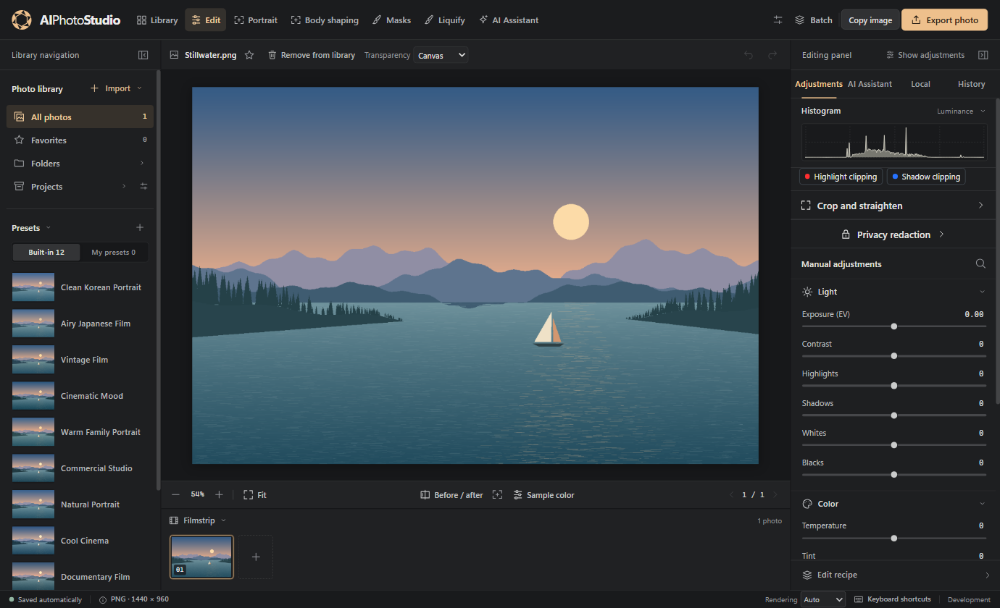

# AI Photo Studio

[简体中文](README.md) · [Edit your first picture](docs/quick-start.en.md) · [Build on Windows](docs/build.md)

AI Photo Studio is a Windows photo editor for people who occasionally edit a portrait, a group picture or an everyday photo. **Version 0.5.0 is a work in progress.** Basic import, editing and export work. Some features are incomplete and bugs are possible. Most editing is manual. The offline AI assistant understands a limited set of instructions and proposes changes to the same controls you use by hand. You review a proposal before it becomes an edit.

**Windows users can run the portable app.** Under Releases → Assets, download **AIPhotoStudio-0.5.0-windows-x64-portable.zip**, select **Extract All**, then open **AIPhotoStudio.exe**. The green **Code → Download ZIP** button downloads source code that needs to be built. [Download the portable app](https://github.com/ROSHANBOSS/AIPhotoStudio/releases/download/v0.5.0/AIPhotoStudio-0.5.0-windows-x64-portable.zip) · [Startup and optional portrait features](docs/portable.md)

## Try it

Build the source on Windows x64 using the [build instructions](docs/build.md), then open `build/development/AIPhotoStudio.exe`. Choose English or Simplified Chinese on the first launch. You can change the language in Settings. Users of the portable ZIP can skip the build.

Choose **Open sample**. In **Edit**, increase Exposure from 0 to +0.45 EV and use **Export photo** to save a new JPEG. The original stays intact. [Step-by-step guide](docs/quick-start.en.md)

## What to expect

- **Manual editing.** Adjust tone, color and framing, paint a mask for a local change, or use history to undo an adjustment.
- **Portraits.** Pick the detected person in a group before applying a change. Check the selection yourself if a face is small, poorly lit or partially hidden. Optional models are obtained separately using the portable guide.
- **AI assistance.** Try “Set exposure to 0.7”. Review the suggested value and apply it if you like it. Cloud providers are optional.
- **Camera RAW.** The original local 0.5.0 acceptance run imported and edited 18 camera files. Support is specific to camera model and encoding. Large files can take several seconds to open.

## Feedback and terms

Include the app version, Windows version, image format, exact steps and the result you expected. When Issues are enabled, reproduce the problem with synthetic content and submit those details. Keep personal photos, full paths, catalogs and API keys private. [Privacy and feedback](docs/privacy.md) · [Changes and limitations](CHANGELOG.md)

First-party material is available under PolyForm Noncommercial 1.0.0. Personal noncommercial editing is free. For commercial use outside the license, obtain prior written permission from the maintainer. Third-party terms remain in effect. [Licensing scope](LICENSE) · [Commercial inquiries](LICENSING.md) · [Third-party notices](THIRD_PARTY_NOTICES.md)
