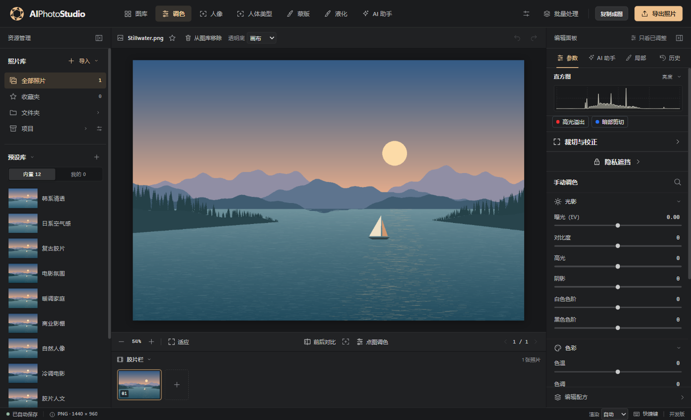

# AI Photo Studio

[English](README.en.md) · [第一次修一张照片](docs/quick-start.md) · [后续计划（第 41–65 项）](docs/roadmap.md) · [从源码构建](docs/build.md)

AI Photo Studio 是一款给偶尔修自拍、合照和日常照片的个人用户使用的 Windows 编辑器。**0.5.0 是开发中的预览版**。导入、手动调色和导出可以使用，部分功能仍在完善，可能遇到 Bug。现在最适合的用法是自己调滑块、裁切和画蒙版。离线 AI 助手还在调整，只能理解部分简单指令，它提出参数改动，由你决定是否应用。

**普通用户下载 Windows 免安装版。** 在 Releases 的 Assets 里下载 **AIPhotoStudio-0.5.0-windows-x64-portable.zip**，右键「全部提取」，再双击文件夹里的 **AIPhotoStudio.exe**。绿色 **Code → Download ZIP** 下载的是源码，需要编译。[下载免安装版](https://github.com/ROSHANBOSS/AIPhotoStudio/releases/download/v0.5.0/AIPhotoStudio-0.5.0-windows-x64-portable.zip) · [下载、启动与可选人物功能](docs/portable.md)

## 开始使用

已有图库的用户，更新前可先备份草稿和编辑记录，并单独保留原片。[升级、备份与恢复](docs/portable.md#升级时保留草稿)

这份源码适用于 Windows x64。按[构建说明](docs/build.md)生成程序，再打开 `build/development/AIPhotoStudio.exe`。首次启动可选简体中文或 English，以后可在设置中切换。直接使用免安装版时可跳过构建。

第一次试用可以点「打开示例」。在「调色」里把曝光从 0 调到 +0.45 EV，再点「导出照片」另存 JPEG。程序保留原片和编辑历史。[四步图解](docs/quick-start.md)

## 可以试什么

| 操作 | 适用范围 |
| --- | --- |
| 手动调整曝光、色彩、构图，撤销或重做 | 适合单张照片，结果通过另存导出。 |
| 蒙版与人像 | 可涂选局部调光，识别后可逐人调整。遮挡、暗光或小脸可能影响识别，需要自己核对选区。免安装版的人物模型按下载教程从 Google 单独获取。 |
| 离线 AI 提案 | 可试“只压低高光”。也可直接操作同一个高光滑块。连接外部服务是可选项。 |
| RAW 文件 | 本地 0.5.0 验收用 18 个实拍文件验证了导入与编辑。兼容范围取决于型号和编码，首次打开高像素 RAW 仍可能需要数秒。 |

## 反馈与使用许可

反馈前请记录软件版本、Windows 版本、图片格式、操作步骤和预期结果。若仓库启用 Issues，可以用合成图复现并提报。私人原片、完整数据库、路径及 API 密钥请保留在本机。[隐私与反馈](docs/privacy.md) · [版本变化和已知限制](CHANGELOG.md)

本公开版的首方代码和素材采用 PolyForm Noncommercial 1.0.0，个人非商业使用免费。超出许可范围的商用须先取得维护者的书面同意。第三方组件保留各自的许可。[授权范围](LICENSE) · [商用联系](LICENSING.md) · [第三方来源](THIRD_PARTY_NOTICES.md)
