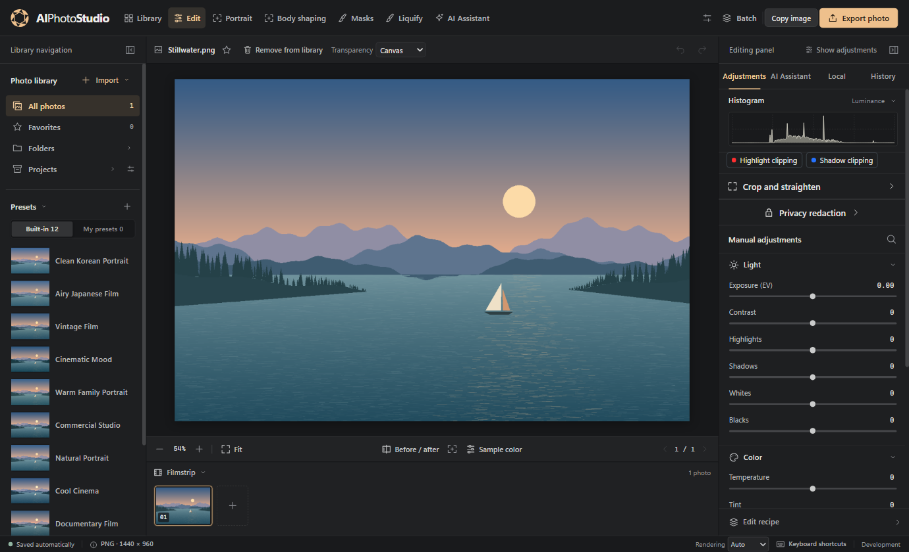

# Edit your first picture

[中文图解](quick-start.md) · [Home](../README.en.md)

First [download and extract the portable ZIP](portable.md), then open **AIPhotoStudio.exe**.

Start the app, choose English, then click **Open sample**. Stillwater.png is a synthetic landscape. If you prefer your own photo, choose **Import photos** and pick a JPEG or PNG.

1. **Brighten the photo.** Open **Edit → Adjustments → Light**. Drag **Exposure (EV)** to +0.45 or enter the value and press Enter. Use **Before / after** to compare the sky and water, or use Undo to restore the previous value.
2. **Optionally try the assistant.** Open **AI Assistant**, enter “Set exposure to 0.7”, and send the instruction. Review the proposed value and choose **Apply proposal** or cancel. Manual editing uses the same parameter and history.
3. **Save a copy.** Choose **Export photo**, select JPEG, keep the current dimensions and choose a new filename such as `Stillwater-edited.jpg`. Open the result in an image viewer. The uncropped sample is 1440 × 960 pixels.
4. **Manage the library.** Use **Remove from library** to hide the current photo and **Library → Recently removed** to restore it. The original file stays on disk.

For a visual walkthrough of the exposure, proposal and export screens, see [the illustrated Chinese guide](quick-start.md).
