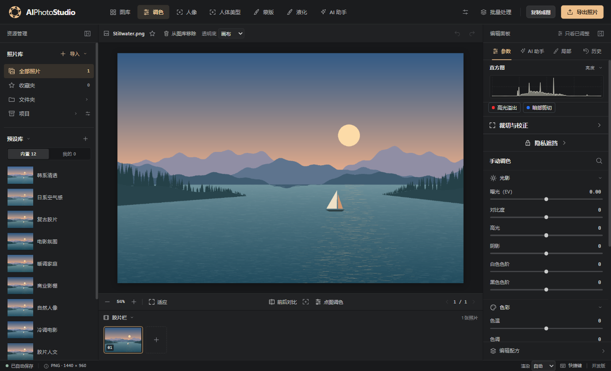
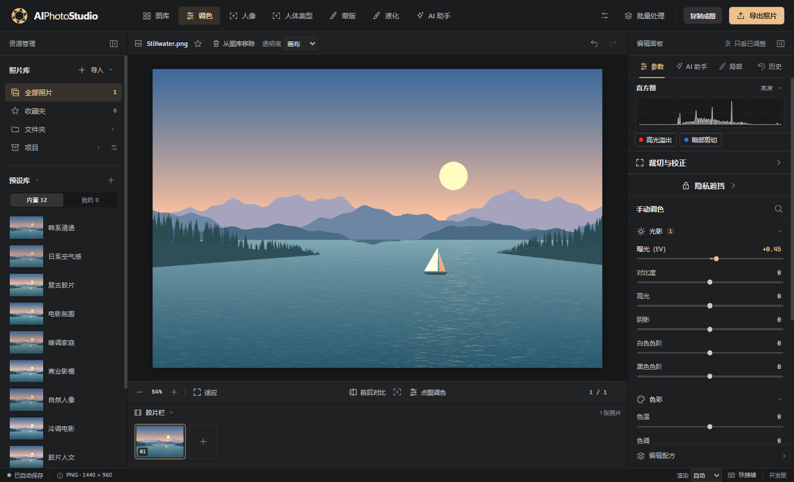
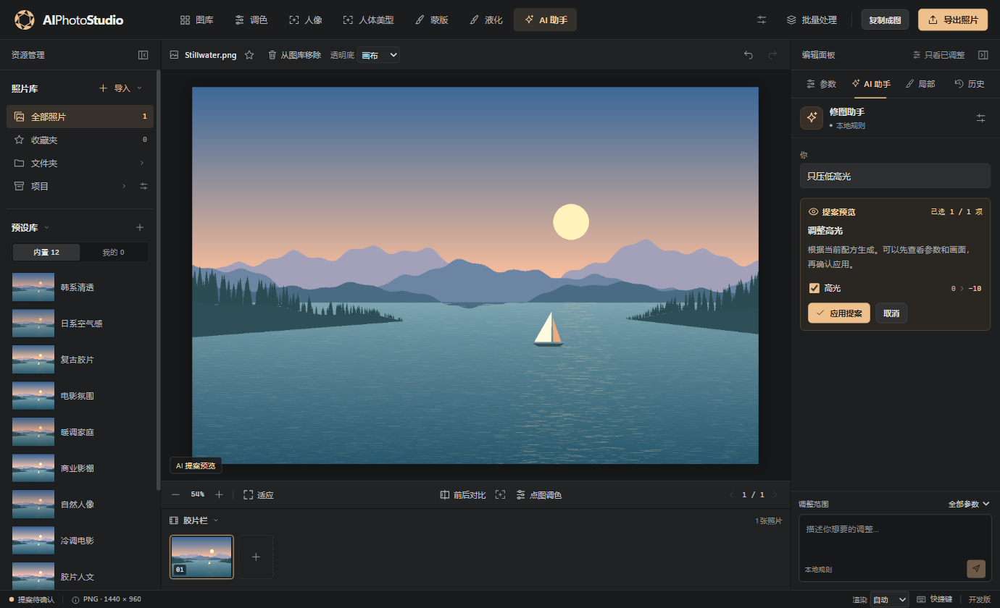
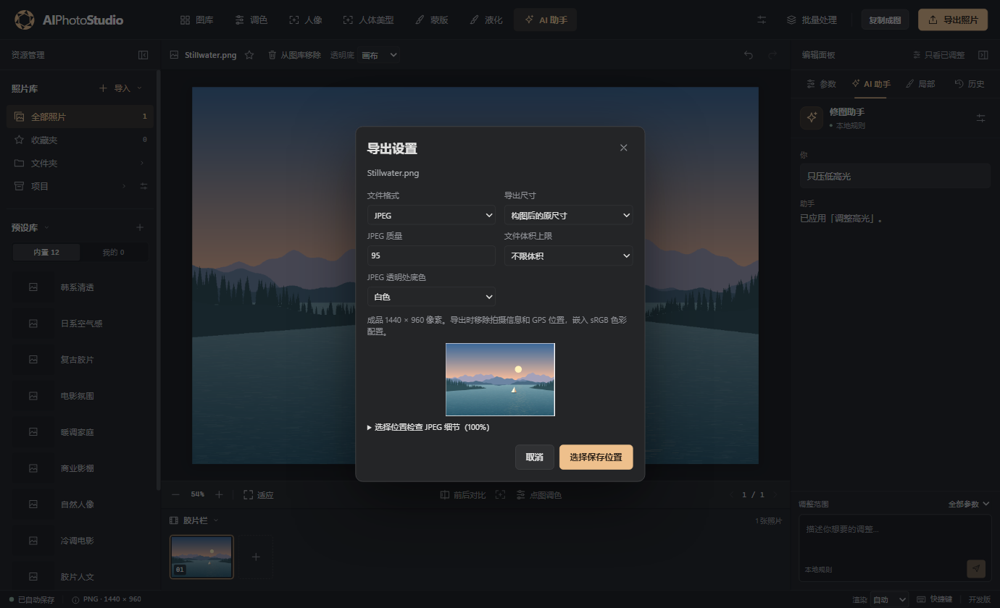

# 第一次修一张照片

[English guide](quick-start.en.md) · [返回首页](../README.md)

还没打开软件？先[下载免安装版并解压](portable.md)，双击 **AIPhotoStudio.exe**。

下面四步用同一张合成湖景，从原始预览到导出一张 JPEG。图中的数值可以照着试，也可以随时用「撤销」退回。

## 1　打开示例

首次启动选择「简体中文」。点「打开示例」载入 Stillwater.png。想修自己的照片时，点「导入照片」选择一张 JPEG 或 PNG。左侧是照片与预设，中间是画布，右侧是当前工具。

## 2　手动把曝光提高半档左右

点顶部「调色」，在右侧「参数 → 手动调色 → 光影」找到「曝光（EV）」。拖动滑块，或点数值输入 `0.45` 再按 Enter。观察船帆、太阳和暗部的变化。想比较时可点画布下方的「前后对比」，想重来时用撤销按钮。

## 3　试一条 AI 指令（可跳过）

点顶部「AI 助手」，输入 **只压低高光** 并发送。这个示例里，右侧提案把高光从 0 调到 −10。先检查参数和画面，再选「应用提案」或「取消」。不使用助手也可以回到「调色」手动调整同一项参数。

## 4　导出并打开成品

点右上角「导出照片」，文件格式选 JPEG，尺寸用「构图后的原尺寸」。点「选择保存位置」，输入新的文件名，例如 `Stillwater-edited.jpg`。然后用图片查看器打开成品。按本例未做裁切时，导出为 1440 × 960 像素。

## 找回照片或调整

- 想取消一次调整，在编辑器用撤销或打开「历史」。
- 想从图库移走当前照片，在画布上方点「从图库移除」，或按 Delete。可在「图库 → 最近移除」找回，磁盘原片仍在导入位置。
- 合照请先在「人体美型」中识别并点选人物。局部调光可进「蒙版」，画出范围后再调局部曝光。第一次试这些操作，先用自己的照片在本机查看效果。
